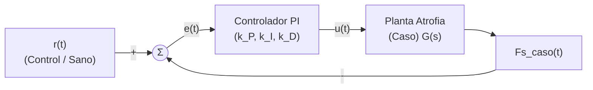
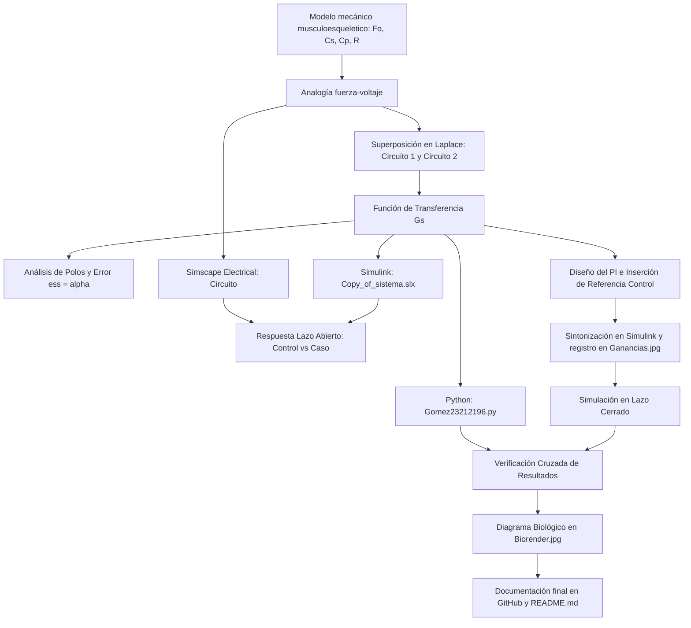

# Práctica 5.5 — Modelado y control del sistema musculoesquelético

Repositorio académico de la asignatura **Modelado de Sistemas Fisiológicos**, correspondiente al programa de **Ingeniería Biomédica** del Tecnológico Nacional de México / Instituto Tecnológico de Tijuana. Esta práctica integra el modelado mecánico del tejido muscular, analogías electromecánicas (fuerza-voltaje), análisis analítico en el dominio de Laplace mediante superposición, simulación computacional *in silico* (MATLAB, Simulink, Simscape y Python) y el diseño de controladores PI para la compensación de la atrofia muscular.

El caso de estudio representa la **dinámica viscoelástica del músculo esquelético** mediante un modelo mecánico de parámetros concentrados (elementos elásticos en serie/paralelo y amortiguamiento viscoso). Se analiza la respuesta del sistema en un individuo sano (**Control**) frente a un escenario simulado de atrofia muscular (**Caso**), implementando un controlador PI que elimina la discrepancia entre ambas respuestas.

**Docente:** Dr. Paul Antonio Valle Trujillo  
**Correo:** paul.valle@tectijuana.edu.mx · paul.vt@tijuana.tecnm.mx  
**Departamento:** Ingeniería Eléctrica y Electrónica  
**Institución:** Tecnológico Nacional de México / Instituto Tecnológico de Tijuana  
**Asignatura:** Modelado de Sistemas Fisiológicos (IBF-1020)  
**Programa:** Ingeniería Biomédica  
**Estudiante:** Emiliano Gómez Quiroa · 23212196 · l23212196@tijuana.tecnm.mx  

**Repositorio de la asignatura:** https://github.com/DrPaulValle/MSF-IBF1020  
**Repositorio del proyecto:** https://github.com/EmiCrack132/MSFP3  
**Sede:** Blvd. Alberto Limón Padilla s/n, Tijuana, C. P. 22454, B. C., México.

---

<a id="contenido"></a>
## Contenido

1. [Resumen](#resumen)
2. [Competencia y objetivos](#objetivos)
3. [Relación con el temario](#temario)
4. [Modelo físico y analogía electromecánica](#analogia)
5. [Formulación matemática](#modelo)
6. [Análisis temporal y de estabilidad](#analisis)
7. [Señales de entrada y condiciones de simulación](#senales)
8. [Implementación en MATLAB, Simulink y Simscape](#matlab)
9. [Control en lazo cerrado y sintonización PI](#PI)
10. [Reproducción en Python](#python)
11. [Resultados y verificación cruzada](#resultados)
12. [Flujo de trabajo](#flujo)
13. [Actividades del estudiante](#actividades)
14. [Estructura del repositorio](#estructura)
15. [Requisitos](#requisitos)
16. [Reproducibilidad y entregables](#reproducibilidad)
17. [Referencias](#referencias)

---

<a id="resumen"></a>
## Resumen

La práctica tuvo como propósito **modelar, analizar y controlar la respuesta dinámica del sistema musculoesquelético** ante un caso de atrofia muscular mediante experimentación *in silico*. El compartimento muscular se representó mediante un modelo mecánico constituido por un elemento contráctil activo ($F_0$), una compliancia elástica en serie ($C_s$), una compliancia elástica en paralelo ($C_p$) y una amortiguación viscosa ($R$).

Haciendo uso de la **analogía fuerza-voltaje**, el sistema mecánico se transformó en un circuito eléctrico equivalente donde las fuerzas corresponden a voltajes, las velocidades a corrientes, las compliancias a capacitancias y la fricción viscosa a resistencias. Debido a la presencia de la fuente dependiente $F_0(t) = \alpha F(t)$, el modelo se dedujo analíticamente utilizando el **principio de superposición en el dominio de Laplace**. Se evaluó la respuesta al impulso y al pulso de excitación en condición normal (control) y se contrastó con la condición de atrofia muscular (caso), caracterizada por un incremento en la componente viscosa ($R$). Finalmente, se sintonizó e implementó un **controlador PI con retroalimentación negativa** para lograr que el tejido atrofiado siga la trayectoria del tejido sano, verificando la consistencia entre MATLAB/Simulink, Simscape Electrical y Python.

**Palabras clave:** Sistema musculoesquelético; Atrofia muscular; Controlador PI; Modelo matemático; Simulaciones numéricas.

[Volver al contenido](#contenido)

---

<a id="objetivos"></a>
## Competencia y objetivos

### Competencia a desarrollar

Modelizar sistemas fisiológicos mediante analogías entre sistemas físicos, ecuaciones diferenciales y funciones de transferencia para analizar su comportamiento dinámico y diseñar estrategias de control mediante técnicas de control clásico. En particular, analizar un modelo mecánico simplificado del sistema musculoesquelético, construir su circuito eléctrico equivalente mediante la analogía fuerza-voltaje, comparar la respuesta de un individuo sano (control) con un caso simulado de atrofia muscular (caso) y diseñar una estrategia de control *in silico* orientada a reducir las diferencias entre ambas respuestas.

### Objetivo general

Formular el modelo matemático del sistema musculoesquelético mediante su analogía eléctrica equivalente, simular su respuesta dinámica en lazo abierto para condiciones de salud y atrofia muscular, y diseñar un sistema de control PI en lazo cerrado que compense la alteración mecánica del tejido.

### Objetivos específicos

- Convertir el modelo mecánico viscoelástico muscular a su circuito eléctrico equivalente utilizando la analogía fuerza-voltaje.
- Derivar analíticamente la función de transferencia $G(s) = \frac{F_s(s)}{F(s)}$ aplicando el principio de superposición en el dominio de Laplace.
- Evaluar la posición del polo $\lambda = -\frac{1}{R(C_p + C_s)}$ y el error en estado estacionario $e_{ss} = \alpha$.
- Implementar y simular ambas condiciones en MATLAB, Simulink y Simscape Electrical ante una entrada de excitación.
- Sintonizar las ganancias ($k_P, k_I, k_D$) de un controlador PI que minimice el error $e(t) = x_{\text{control}}(t) - x_{\text{caso}}(t)$.
- Reproducir el comportamiento dinámico en lazo abierto y lazo cerrado mediante el script de Python `Gomez23212196.py`.
- Elaborar un diagrama biológico detallado en BioRender (`Biorender.jpg`) que vincule la estructura anatómica del músculo y tendón con los componentes del modelo.

[Volver al contenido](#contenido)

---

<a id="temario"></a>
## Relación con el temario

La práctica integró contenidos correspondientes a las unidades temáticas de la asignatura **Modelado de Sistemas Fisiológicos (IBF-1020)**:

| Unidad | Área | Contenidos aplicados |
|---|---|---|
| I | Sistemas de control retroalimentados | Diagramas de bloques, respuesta temporal, error de seguimiento $e_{ss} = \alpha$ y análisis de estabilidad de polos |
| II | Modelado matemático | Analogía mecánica (fuerza-voltaje), principio de superposición, modelos de parámetros concentrados del sistema musculoesquelético y funciones de transferencia |
| III | Controladores | Controladores PI, sintonización de ganancias y sistemas de compensación *in silico* |

[Volver al contenido](#contenido)

---

<a id="analogia"></a>
## Modelo físico y analogía electromecánica

El compartimento musculoesquelético se modeló mecánicamente como un elemento contráctil activo que genera una fuerza $F_0(t) = \alpha F(t)$ ($0 < \alpha < 1$), conectado en paralelo con una estructura viscosa $R$ y en serie con la elasticidad tendinosa/sarcolémica $C_s$, todo en paralelo con la elasticidad pasiva del tejido $C_p$.

### Equivalencias de la analogía fuerza-voltaje

| Variable / Elemento mecánico | Variable / Elemento eléctrico equivalente | Interpretación fisiológica |
|---|---|---|
| Fuerza $F(t)$ | Voltaje $V(t)$ | Fuerza neta transmitida por el sistema muscular |
| Velocidad $\dot{x}(t)$ | Corriente $I(t)$ | Velocidad de deformación del tejido muscular |
| Desplazamiento $x(t)$ | Carga eléctrica $q(t)$ | Deformación o elongación del músculo |
| Amortiguador $R$ | Resistencia $R$ | Amortiguación y resistencia viscosa del tejido |
| Compliancia mecánica $C_s, C_p$ | Capacitancia $C_s, C_p$ | Elasticidad de tendones ($C_s$) y del tejido pasivo ($C_p$) |

> **Nota sobre topología:** En la analogía fuerza-voltaje, los elementos mecánicos conectados en paralelo se convierten en elementos eléctricos en serie, y los elementos mecánicos en serie se convierten en capacitancias/resistencias en paralelo.

### Parámetros para la simulación *in silico*

| Parámetro | Control (Sano) | Caso (Atrofia Muscular) | Unidad eléctrica | Interpretación fisiológica |
|---|---:|---:|---|---|
| $F(t)$ | $1$ | $1$ | $\mathrm{V}$ | Fuerza de excitación externa ($1\,\mathrm{N}$ análogo) |
| $\alpha$ | $0.25$ | $0.25$ | Adimensional | Fracción de fuerza activa del elemento contráctil |
| $C_s$ | $10$ | $10$ | $\mu\mathrm{F}$ | Elasticidad del elemento en serie (tendón/sarcolema) |
| $C_p$ | $100$ | $100$ | $\mu\mathrm{F}$ | Elasticidad pasiva en paralelo |
| $R$ | $100$ | $10\,000$ ($10\,\mathrm{k}$) | $\Omega$ | Coeficiente de fricción/viscosidad muscular |

La atrofia muscular se simuló mediante un incremento severo en la componente de resistencia viscosa ($R = 100\,\Omega \to 10\,\mathrm{k}\Omega$), lo cual degrada la dinámica de deformación del tejido.

[Volver al contenido](#contenido)

---

<a id="modelo"></a>
## Formulación matemática

Al existir una fuerza activa dependiente $F_0(t) = \alpha F(t)$, se aplicó el **principio de superposición** en el dominio de Laplace para determinar la respuesta total $F_s(s) = F_{s1}(s) + F_{s2}(s)$, cuya deducción completa se incluye en `Análisis matemático P3.pdf`.

### 1. Circuito 1: Apagando la fuente dependiente $F_0(t)$

Al considerar solo la fuerza externa $F(t)$:

$$C_p \frac{d F_{s1}(t)}{dt} = C_s \frac{d\left(F(t) - F_{s1}(t)\right)}{dt} + \frac{F(t) - F_{s1}(t)}{R}$$

Transformando al dominio de Laplace con condiciones iniciales nulas:

$$C_p s F_{s1}(s) = C_s s \left(F(s) - F_{s1}(s)\right) + \frac{F(s) - F_{s1}(s)}{R}$$

Despejando $F_{s1}(s)$:

$$F_{s1}(s) = \frac{R C_s s + 1}{R(C_p + C_s) s + 1} F(s)$$

### 2. Circuito 2: Apagando la fuerza externa $F(t)$

Considerando únicamente la contribución de $F_0(t) = \alpha F(t)$:

$$-\alpha F(s) = R x(s) + \frac{x(s)}{(C_p + C_s) s}$$

Sabiendo que $F_{s2}(s) = \frac{x(s)}{(C_p + C_s) s}$, se obtiene:

$$F_{s2}(s) = \frac{-\alpha}{R(C_p + C_s) s + 1} F(s)$$

### 3. Función de transferencia global

Sumando las componentes $F_{s1}(s)$ y $F_{s2}(s)$:

$$F_s(s) = \frac{R C_s s + 1}{R(C_p + C_s) s + 1} F(s) - \frac{\alpha}{R(C_p + C_s) s + 1} F(s)$$

Por lo tanto, la función de transferencia del sistema muscular es:

$$\boxed{G(s) = \frac{F_s(s)}{F(s)} = \frac{R C_s s + 1 - \alpha}{R (C_p + C_s) s + 1}}$$

[Volver al contenido](#contenido)

---

<a id="analisis"></a>
## Análisis temporal y de estabilidad

### 1. Ubicación del polo y estabilidad en lazo abierto

El polinomio del denominador establece el polo característico del sistema:

$$R (C_p + C_s) s + 1 = 0 \implies \lambda = -\frac{1}{R(C_p + C_s)}$$

Dado que los parámetros físicos de la compliancia y fricción son positivos ($R, C_p, C_s > 0$), la raíz se encuentra strictly en el semiplano izquierdo ($\mathrm{Re}(\lambda) < 0$), garantizando estabilidad BIBO en condición sana y de atrofia.

### 2. Error en estado estacionario ($e_{ss}$)

Ante una entrada en escalón unitario $F(s) = \frac{1}{s}$, el Teorema del Valor Final indica:

$$e_{ss} = \lim_{s \to 0} s F(s) \left[1 - G(s)\right] = \lim_{s \to 0} s \left(\frac{1}{s}\right) \left[1 - \frac{R C_s s + 1 - \alpha}{R(C_p + C_s) s + 1}\right] = 1 - (1 - \alpha) = \alpha$$

El error en estado estacionario del sistema muscular equivale numéricamente a la fracción de activación $\alpha$.

[Volver al contenido](#contenido)

---

<a id="senales"></a>
## Señales de entrada y condiciones de simulación

- **Entrada nominal:** Pulso de fuerza $F(t)$ de magnitud $1\,\mathrm{V}$ aplicado entre $t = 1\,\mathrm{s}$ y $t = 2\,\mathrm{s}$.
- **Intervalo de simulación:** $0 \le t \le 10\,\mathrm{s}$.
- **Criterio de error a compensar:** $e(t) = F_{s, \text{control}}(t) - F_{s, \text{caso}}(t)$.

[Volver al contenido](#contenido)

---

<a id="matlab"></a>
## Implementación en MATLAB, Simulink y Simscape

Se construyeron e implementaron las representaciones equivalentes del sistema en lazo abierto y lazo cerrado dentro del archivo `Copy_of_sistema.slx`:

1. **Ecuaciones del sistema:** Bloques de operaciones matemáticas e integradores en Simulink.
2. **Función de transferencia:** Bloque `Transfer Fcn` evaluando $G(s) = \frac{R C_s s + 1 - \alpha}{R (C_p + C_s) s + 1}$.
3. **Circuito equivalente (Simscape):** Componentes físicos $R$, $C_s$ y $C_p$ de *Simscape Electrical*.

El cuaderno computacional `Gomez23212196.mlx` ejecuta las simulaciones, extrae las variables al *Workspace* y exporta los gráficos resultantes a `Gomez23212196.pdf` y `Muscoesqueletico_matlab.pdf`.

[Volver al contenido](#contenido)

---

<a id="PI"></a>
## Control en lazo cerrado y sintonización PI

### 1. Esquema de control

Se diseñó una estructura de control retroalimentada donde la respuesta del músculo sano $F_{s, \text{control}}(t)$ ingresa como señal de referencia $r(t)$ para guiar la respuesta del tejido atrofiado $F_{s, \text{caso}}(t)$:



### 2. Sintonización de ganancias

Mediante la herramienta **Tune** del bloque `PI Controller` en Simulink, se sintonizaron las ganancias del controlador para el modelo de atrofia (registradas en `Ganancias.jpg`):

- Ganancia Proporcional ($k_P$): *Valor sintonizado en PI Tune*
- Ganancia Integral ($k_I$): *Valor sintonizado en PI Tune*
- Ganancia Derivativa ($k_D$): *Valor sintonizado en PI Tune*

El controlador PI implementado obliga al tejido muscular atrófico a responder de manera idéntica al tejido sano.

[Volver al contenido](#contenido)

---

<a id="python"></a>
## Reproducción en Python

Mediante el script en Python (`Gomez23212196.py`) y las librerías `scipy.signal` y `matplotlib`, se realizó la simulación numérica independiente para verificar los resultados obtenidos en MATLAB/Simulink:

1. Definición de las funciones de transferencia $G_{\text{control}}(s)$ y $G_{\text{caso}}(s)$.
2. Simulación de la respuesta dinámica ante la entrada $F(t)$.
3. Implementación del lazo cerrado con las ganancias $k_P, k_I, k_D$ sintonizadas.
4. Exportación gráfica a `Muscoesqueletico_python.pdf`.

[Volver al contenido](#contenido)

---

<a id="resultados"></a>
## Resultados y verificación cruzada

En los archivos `Muscoesqueletico_matlab.pdf` y `Muscoesqueletico_python.pdf` se muestran de forma comparativa las señales del sistema:

- **Señal de entrada $F(t)$:** Pulso de excitación de $1\,\mathrm{V}$ aplicado entre $t=1\,\mathrm{s}$ y $t=2\,\mathrm{s}$.
- **Respuesta de Control $F_s(t)$:** Comportamiento dinámico del tejido muscular sano en condición normal.
- **Respuesta de Caso $F_s(t)$:** Respuesta del tejido con atrofia muscular en lazo abierto, evidenciando un retraso severo y dinamismo sobreamortiguado debido a la mayor viscosidad $R$.
- **Tratamiento PI:** Respuesta del tejido atrófico compensado mediante el controlador en lazo cerrado, logrando una superposición exacta con la trayectoria del individuo sano.

### Archivos de resultados generados

| Condición | MATLAB / Simulink | Python |
|---|---|---|
| Respuesta dinámica y PI | `Muscoesqueletico_matlab.pdf` | `Muscoesqueletico_python.pdf` |

- Demostración matemática: `Análisis matemático P3.pdf`
- Evidencia de sintonización PI: `Ganancias.jpg`
- Diagrama biológico: `Biorender.jpg`

[Volver al contenido](#contenido)

---

<a id="flujo"></a>
## Flujo de trabajo



[Volver al contenido](#contenido)

---

<a id="actividades"></a>
## Actividades del estudiante

### Etapa 1. Formulación analítica

- [x] Identificar la función de los elementos $F_0, F, R, C_p, C_s, x(t), x_1(t)$.
- [x] Construir el circuito eléctrico equivalente usando la analogía fuerza-voltaje.
- [x] Obtener la función de transferencia $G(s) = \frac{R C_s s + 1 - \alpha}{R (C_p + C_s) s + 1}$ aplicando el principio de superposición (`Análisis matemático P3.pdf`).
- [x] Determinar el polo del sistema $\lambda = -\frac{1}{R(C_p + C_s)}$ y el error en estado estacionario $e_{ss} = \alpha$.

### Etapa 2. Simulación *in silico* de la planta

- [x] Implementar la representación por ecuaciones y función de transferencia en Simulink (`Copy_of_sistema.slx`).
- [x] Implementar el circuito equivalente en Simscape Electrical.
- [x] Obtener la respuesta temporal para Control y Caso en lazo abierto.

### Etapa 3. Control PI y compensación de atrofia

- [x] Configurar el lazo cerrado tomando la respuesta de Control como referencia.
- [x] Sintonizar el PI mediante la herramienta Tune y registrar $k_P, k_I, k_D$ en `Ganancias.jpg`.
- [x] Ejecutar el cuaderno de MATLAB (`Gomez23212196.mlx`) y exportar a PDF (`Gomez23212196.pdf` y `Muscoesqueletico_matlab.pdf`).
- [x] Reproducir la simulación en Python con el script `Gomez23212196.py` y generar `Muscoesqueletico_python.pdf`.

### Etapa 4. Documentación y diagrama biológico

- [x] Diseñar el diagrama del sistema musculoesquelético en BioRender (`Biorender.jpg`).
- [x] Redactar la interpretación fisiológica y la discusión de resultados.
- [x] Publicar la versión final en GitHub con los archivos `LICENSE` y `CITATION.cff`.

[Volver al contenido](#contenido)

---

<a id="estructura"></a>
## Estructura del repositorio

```text
.
├── README.md                      # Reporte principal de la práctica
├── CITATION.cff                   # Archivo de citación del repositorio
├── LICENSE                        # Licencia del repositorio
├── Análisis matemático P3.pdf    # Demostración matemática analítica por superposición
├── Biorender.jpg                  # Diagrama biológico del músculo y tendón
├── Copy_of_sistema.slx            # Modelo en Simulink / Simscape Electrical
├── Ganancias.jpg                  # Evidencia de sintonización de ganancias PI (PI Tune)
├── Gomez23212196.mlx              # Cuaderno MATLAB de simulación
├── Gomez23212196.pdf              # Exportación en PDF del cuaderno MATLAB
├── Gomez23212196.py               # Script de simulación en Python
├── Muscoesqueletico_matlab.pdf    # Gráfica de respuesta obtenida en MATLAB
└── Muscoesqueletico_python.pdf    # Gráfica de respuesta obtenida en Python
```

[Volver al contenido](#contenido)

---

<a id="requisitos"></a>
## Requisitos

### Software

- **MATLAB** y **Simulink** (con *Control System Toolbox*).
- **Simscape Electrical**.
- **Python 3.x** (con librerías `numpy`, `scipy`, `matplotlib`).
- **Visual Studio Code**.
- **BioRender** (para la elaboración del diagrama biológico `Biorender.jpg`).
- **Git y GitHub**.

[Volver al contenido](#contenido)

---

<a id="reproducibilidad"></a>
## Reproducibilidad y entregables

### Resultados mínimos esperados

| Entregable | Evidencia solicitada |
|---|---|
| Formulación matemática | Analogía fuerza-voltaje, superposición y función de transferencia en `Análisis matemático P3.pdf` |
| Simulación lazo abierto | Comparación gráfica entre Control y Caso en `Muscoesqueletico_matlab.pdf` |
| Sintonización PI | Ganancias $k_P, k_I$ en `Ganancias.jpg` y gráfico de tratamiento PI |
| Código Python | Script funcional `Gomez23212196.py` y gráfica `Muscoesqueletico_python.pdf` |
| Diagrama biológico | Esquema anatómico en `Biorender.jpg` |
| Documentación | Repositorio GitHub con `README.md` estructurado, `LICENSE` y `CITATION.cff` |

[Volver al contenido](#contenido)

---

<a id="referencias"></a>
## Referencias

[1] M. C. Khoo, *Physiological Control Systems: Analysis, Simulation, and Estimation*, 2nd ed., IEEE Press, 2018.

[2] F. C. Hoppensteadt y C. S. Peskin, *Modeling and Simulation in Medicine and the Life Sciences*, 2nd ed., Springer, 2002.

[3] J. E. Hall, *Guyton and Hall Textbook of Medical Physiology*, 14th ed., Elsevier, 2021.

[4] K. Ogata, *Ingeniería de Control Moderna*, 5.ª ed., Pearson Educación, 2010.

[5] N. S. Nise, *Control Systems Engineering*, 8th ed., John Wiley & Sons, 2020.

[6] P. A. Valle, *Syllabus para Modelado de Sistemas Fisiológicos*, Tecnológico Nacional de México / Instituto Tecnológico de Tijuana, Tijuana, B. C., México, 2026.

[7] Tecnológico Nacional de México, *Programa de estudio de la asignatura Modelado de Sistemas Fisiológicos, IBF-1020*.

---

## Uso académico

Este repositorio se utiliza como evidencia del desarrollo de la **Práctica 5.5: Modelado y control del sistema musculoesquelético**. Su objetivo central fue la experimentación *in silico* mediante analogías electromecánicas y técnicas de control clásico para compensar alterations biológicas como la atrofia muscular.
