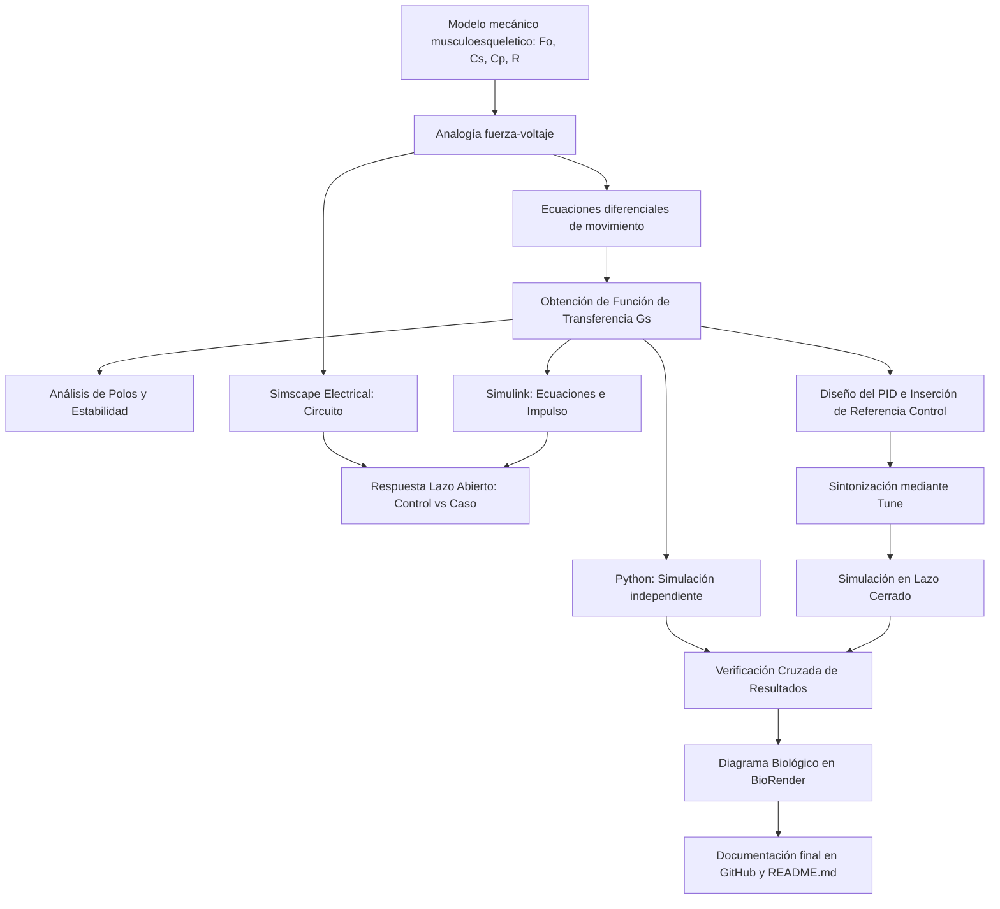

# Práctica 5.5 — Modelado y control del sistema musculoesquelético

Repositorio académico de la asignatura **Modelado de Sistemas Fisiológicos**, correspondiente al programa de **Ingeniería Biomédica** del Tecnológico Nacional de México / Instituto Tecnológico de Tijuana. Esta práctica integra modelado mecánico del tejido muscular, analogías electromecánicas (fuerza-voltaje), análisis en el dominio de Laplace, simulación computacional *in silico* (MATLAB, Simulink, Simscape y Python) y diseño de controladores PID para la compensación de atrofia muscular.

El caso de estudio representa la **dinámica viscoelástica del músculo esquelético** mediante un modelo mecánico de parámetros concentrados (elementos elásticos en serie/paralelo y amortiguamiento viscoso). Se busca comparar la respuesta del sistema en un individuo sano (**Control**) frente a un escenario simulado de atrofia muscular (**Caso**), diseñando un controlador PID que reduzca la discrepancia entre ambas respuestas.

**Docente:** Dr. Paul Antonio Valle Trujillo  
**Correo:** paul.valle@tectijuana.edu.mx · paul.vt@tijuana.tecnm.mx  
**Departamento:** Ingeniería Eléctrica y Electrónica  
**Institución:** Tecnológico Nacional de México / Instituto Tecnológico de Tijuana  
**Asignatura:** Modelado de Sistemas Fisiológicos (IBF-1020)  
**Programa:** Ingeniería Biomédica  
**Estudiante:** Nombre completo · Número de control · correo@tijuana.tecnm.mx

**Repositorio de la asignatura:** https://github.com/DrPaulValle/MSF-IBF1020  
**Sede:** Blvd. Alberto Limón Padilla s/n, Tijuana, C. P. 22454, B. C., México.

---

<a id="contenido"></a>
## Contenido

1. [Resumen](#resumen)
2. [Competencia y objetivos](#objetivos)
3. [Relación con el temario](#temario)
4. [Modelo físico y analogía electromecánica](#analogia)
5. [Formulación matemática](#modelo)
6. [Análisis temporal y de estabilidad](#analisis)
7. [Señales de entrada y condiciones de simulación](#senales)
8. [Implementación en MATLAB, Simulink y Simscape](#matlab)
9. [Control en lazo cerrado y sintonización PID](#pid)
10. [Reproducción en Python](#python)
11. [Resultados y verificación cruzada](#resultados)
12. [Flujo de trabajo](#flujo)
13. [Actividades del estudiante](#actividades)
14. [Estructura del repositorio](#estructura)
15. [Requisitos](#requisitos)
16. [Reproducibilidad y entregables](#reproducibilidad)
17. [Referencias](#referencias)

---

<a id="resumen"></a>
## Resumen

La práctica tiene como propósito **modelar, analizar y controlar la respuesta dinámica del sistema musculoesquelético** ante un caso de atrofia muscular mediante experimentación *in silico*. El compartimento muscular se representa mediante un modelo mecánico constituido por un elemento contráctil activo ($F_0$), una compliancia elástica en serie ($C_s$), una compliancia elástica en paralelo ($C_p$) y una amortiguación viscosa ($R$).

Haciendo uso de la **analogía fuerza-voltaje**, el sistema mecánico se transforma en un circuito eléctrico equivalente donde las fuerzas corresponden a voltajes, las velocidades a corrientes, las compliancias a capacitancias y la fricción viscosa a resistencias. Se evalúa la respuesta al impulso unitario del sistema en condición normal (control) y se contrasta con la condición de atrofia muscular (caso), caracterizada por un incremento en la componente viscosa ($R$). Finalmente, se sintoniza e implementa un **controlador PID con retroalimentación negativa** para lograr que el tejido atrofiado siga la trayectoria del tejido sano, verificando la consistencia entre MATLAB/Simulink, Simscape Electrical y Python.

**Palabras clave:** Sistema musculoesquelético; Atrofia muscular; Analogía fuerza-voltaje; Controlador PID; Simulación in silico.

[Volver al contenido](#contenido)

---

<a id="objetivos"></a>
## Competencia y objetivos

### Competencia a desarrollar

Modelizar sistemas fisiológicos mediante analogías entre sistemas físicos, ecuaciones diferenciales y funciones de transferencia para analizar su comportamiento dinámico y diseñar estrategias de control mediante técnicas de control clásico. En particular, analizar un modelo mecánico simplificado del sistema musculoesquelético, construir su circuito eléctrico equivalente mediante la analogía fuerza-voltaje, comparar la respuesta de un individuo sano (control) con un caso simulado de atrofia muscular (caso) y diseñar una estrategia de control *in silico* orientada a reducir las diferencias entre ambas respuestas.

### Objetivo general

Formular el modelo matemático del sistema musculoesquelético mediante su analogía eléctrica equivalente, simular su respuesta dinámica en lazo abierto para condiciones de salud y atrofia muscular, y diseñar un sistema de control PID en lazo cerrado que compense la alteración mecánica del tejido.

### Objetivos específicos

- Convertir el modelo mecánico viscoelástico muscular a su circuito eléctrico equivalente utilizando la analogía fuerza-voltaje.
- Obtener la función de transferencia $G(s) = X(s)/F(s)$ que relaciona la fuerza aplicada con el desplazamiento muscular.
- Analizar la ubicación de polos, la estabilidad y el error en estado estacionario para las condiciones de control y caso.
- Implementar y simular ambas condiciones en MATLAB, Simulink y Simscape Electrical ante una entrada de impulso unitario.
- Sintonizar las ganancias ($k_P, k_I, k_D$) de un controlador PID que minimice el error $e(t) = x_{\text{control}}(t) - x_{\text{caso}}(t)$.
- Reproducir el comportamiento dinámico en lazo abierto y lazo cerrado mediante scripts de Python.
- Elaborar un diagrama biológico detallado en BioRender que vincule la estructura anatómica del músculo y tendón con los componentes del modelo.

[Volver al contenido](#contenido)

---

<a id="temario"></a>
## Relación con el temario

La práctica integra contenidos correspondientes a las unidades temáticas de la asignatura **Modelado de Sistemas Fisiológicos (IBF-1020)**:

| Unidad | Área | Contenidos aplicados |
|---|---|---|
| I | Sistemas de control retroalimentados | Diagramas de bloques, respuesta al impulso, error de seguimiento y análisis de estabilidad de polos |
| II | Modelado matemático | Analogía mecánica (fuerza-voltaje), modelos de parámetros concentrados del sistema musculoesquelético y funciones de transferencia |
| III | Controladores | Controladores PID, sintonización de ganancias y sistemas de compensación *in silico* |

[Volver al contenido](#contenido)

---

<a id="analogia"></a>
## Modelo físico y analogía electromecánica

El compartimento musculoesquelético se modela mecánicamente como un elemento contráctil activo que genera una fuerza $F_0(t) = \alpha F(t)$ ($0 < \alpha < 1$), conectado en paralelo con una estructura viscosa $R$ y en serie con la elasticidad tendinosa/sarcolémica $C_s$, todo en paralelo con la elasticidad pasiva del tejido $C_p$.

### Equivalencias de la analogía fuerza-voltaje

| Variable / Elemento mecánico | Variable / Elemento eléctrico equivalente | Interpretación fisiológica |
|---|---|---|
| Fuerza $F(t)$ | Voltaje $V(t)$ | Fuerza neta transmitida por el sistema muscular |
| Velocidad $\dot{x}(t)$ | Corriente $I(t)$ | Velocidad de deformación del tejido muscular |
| Desplazamiento $x(t)$ | Carga eléctrica $q(t)$ | Deformación o elongación del músculo |
| Amortiguador $R$ | Resistencia $R$ | Amortiguación y resistencia viscosa del tejido |
| Compliancia mecánica $C_s, C_p$ | Capacitancia $C_s, C_p$ | Elasticidad de tendones ($C_s$) y del tejido pasivo ($C_p$) |

> **Nota sobre topología:** En la analogía fuerza-voltaje, los elementos mecánicos conectados en paralelo se convierten en elementos eléctricos en serie, y los elementos mecánicos en serie se convierten en capacitancias/resistencias en paralelo.

### Parámetros para la simulación *in silico*

| Parámetro | Control (Sano) | Caso (Atrofia Muscular) | Unidad eléctrica | Interpretación fisiológica |
|---|---:|---:|---|---|
| $F(t)$ | $1$ | $1$ | $\mathrm{V}$ | Fuerza de excitación externa ($1\,\mathrm{N}$ análogo) |
| $\alpha$ | $0.25$ | $0.25$ | Adimensional | Fracción de fuerza activa del elemento contráctil |
| $C_s$ | $10$ | $10$ | $\mu\mathrm{F}$ | Elasticidad del elemento en serie (tendón/sarcolema) |
| $C_p$ | $100$ | $100$ | $\mu\mathrm{F}$ | Elasticidad pasiva en paralelo |
| $R$ | $100$ | $10\,000$ ($10\,\mathrm{k}$) | $\Omega$ | Coeficiente de fricción/viscosidad muscular |

La atrofia muscular se simula mediante un incremento severo en la componente de resistencia viscosa ($R = 100\,\Omega \to 10\,\mathrm{k}\Omega$), lo cual degrada la dinámica de deformación del tejido.

[Volver al contenido](#contenido)

---

<a id="modelo"></a>
## Formulación matemática

### 1. Ecuaciones del sistema mecánico y circuito equivalente

A partir del equilibrio de fuerzas en los nodos de deformación $x(t)$ y $x_1(t)$, y aplicando la transformada de Laplace con condiciones iniciales nulas:

$$F(t) = F_0(t) + R \frac{d}{dt}[x(t) - x_1(t)] + \frac{1}{C_p} x(t)$$

### 2. Función de transferencia

Relacionando la entrada de fuerza $F(s)$ con el desplazamiento muscular $X(s)$, se obtiene la función de transferencia del sistema $G(s) = \frac{X(s)}{F(s)}$:

$$G(s) = \frac{X(s)}{F(s)} = \frac{(1 - \alpha) R C_s s + 1}{R C_s s \left( \frac{1}{C_p} \right) + \frac{1}{C_s} + \frac{1}{C_p}}$$

*(Sustituir los valores numéricos específicos correspondientes a las tablas de **Control** y **Caso** para obtener $G_{\text{control}}(s)$ y $G_{\text{caso}}(s)$)*.

[Volver al contenido](#contenido)

---

<a id="analisis"></a>
## Análisis temporal y de estabilidad

### 1. Polos y estabilidad
Se evalúan las raíces del denominador de $G_{\text{control}}(s)$ y $G_{\text{caso}}(s)$. Dado que todos los coeficientes de la planta son reales y positivos, los polos se localizan en el semiplano izquierdo del plano complejo ($\mathrm{Re}(\lambda_i) < 0$), garantizando la estabilidad BIBO del sistema tanto en condición sana como en atrofia.

### 2. Respuesta al impulso unitario
Se analiza la respuesta transitoria del desplazamiento $x(t)$ ante una entrada de impulso unitario $F(t) = \delta(t)$ en el intervalo $0 \le t \le 10\,\mathrm{s}$. La elevada resistencia en el **Caso** genera un sobreamortiguamiento severo y una lentitud considerable en la recuperación del desplazamiento muscular respecto al **Control**.

[Volver al contenido](#contenido)

---

<a id="senales"></a>
## Señales de entrada y condiciones de simulación

- **Entrada nominal:** Impulso unitario de fuerza $F(t) = \delta(t)$ (representado analíticamente o mediante un pulso de corta duración para la experimentación *in silico*).
- **Intervalo de simulación:** $0 \le t \le 10\,\mathrm{s}$.
- **Criterio de error:** $e(t) = x_{\text{control}}(t) - x_{\text{caso}}(t)$.

[Volver al contenido](#contenido)

---

<a id="matlab"></a>
## Implementación en MATLAB, Simulink y Simscape

Se construyen e implementan tres representaciones equivalentes del sistema en lazo abierto y lazo cerrado:

1. **Ecuaciones del sistema:** Bloques de operaciones matemáticas e integradores en Simulink.
2. **Función de transferencia:** Bloque `Transfer Fcn` con $G_{\text{control}}(s)$ y $G_{\text{caso}}(s)$.
3. **Circuito equivalente (Simscape):** Componentes físicos $R$, $C_s$ y $C_p$ de *Simscape Electrical*.

El cuaderno computacional `.mlx` ejecuta automáticamente las simulaciones, extrae las variables al *Workspace* y exporta las respuestas en formato PDF.

[Volver al contenido](#contenido)

---

<a id="pid"></a>
## Control en lazo cerrado y sintonización PID

### 1. Esquema de control

Se establece un esquema de retroalimentación donde la salida del individuo sano $x_{\text{control}}(t)$ actúa como la señal de referencia $r(t)$. La señal de error $e(t) = x_{\text{control}}(t) - x_{\text{caso}}(t)$ alimenta al controlador PID, el cual aplica una fuerza de compensación $u(t)$ sobre el modelo atrófico (Caso).

```text
               +-----+  e(t)   +---------+  u(t)   +---------------+  x_caso(t)
r(t) ----(+)-->| Sum |-------->| PID(s)  |-------->| Planta Caso   |------> Output
  (Control) ^  +-----+         +---------+         +---------------+   |
            |                                                          |
            +--------------------(-------------------------------------+
```

### 2. Sintonización de ganancias

Mediante la herramienta **Tune** del bloque `PID Controller` en Simulink, se sintonizan las ganancias del controlador para el modelo de atrofia:

- Ganancia Proporcional ($k_P$): *[Insertar valor sintonizado]*
- Ganancia Integral ($k_I$): *[Insertar valor sintonizado]*
- Ganancia Derivativa ($k_D$): *[Insertar valor sintonizado]*

El objetivo del controlador PID es forzar al tejido muscular atrófico a responder con la misma rapidez y amortiguamiento del tejido sano.

[Volver al contenido](#contenido)

---

<a id="python"></a>
## Reproducción en Python

Mediante un script independiente en Python (`modelo_musculoesqueletico.py`) y las librerías `scipy.signal` y `matplotlib`, se realiza la simulación numérica independiente para verificar los resultados de MATLAB/Simulink:

1. Definición de funciones de transferencia $G_{\text{control}}(s)$ y $G_{\text{caso}}(s)$.
2. Cálculo de la respuesta al impulso (`scipy.signal.impulse`).
3. Implementación de lazo cerrado con las ganancias $k_P, k_I, k_D$ sintonizadas.
4. Exportación gráfica de la comparación entre Control, Caso en lazo abierto y Caso con PID.

[Volver al contenido](#contenido)

---

<a id="resultados"></a>
## Resultados y verificación cruzada

Las figuras de resultados deben mostrar de forma comparativa las señales:

- **Amarillo / Referencia:** Desplazamiento del tejido sano, $x_{\text{control}}(t)$.
- **Azul / Caso lazo abierto:** Desplazamiento del tejido atrófico sin control, $x_{\text{caso}}(t)$.
- **Verde / Lazo cerrado PID:** Desplazamiento del tejido atrófico compensado, $x_{\text{PID}}(t)$.

### Archivos de resultados generados

| Condición | MATLAB / Simulink | Python |
|---|---|---|
| Respuesta al Impulso | `impulse_matlab.pdf` | `impulse_python.pdf` |

Diagrama de bloques de control y circuito Simscape: `musculo_esquema.png`.

[Volver al contenido](#contenido)

---

<a id="flujo"></a>
## Flujo de trabajo



[Volver al contenido](#contenido)

---

<a id="actividades"></a>
## Actividades del estudiante

### Etapa 1. Formulación analítica

- [ ] Identificar la función de los elementos $F_0, F, R, C_p, C_s, x(t), x_1(t)$.
- [ ] Construir el circuito eléctrico equivalente usando la analogía fuerza-voltaje.
- [ ] Obtener la función de transferencia $G(s) = X(s)/F(s)$ para Control y Caso.
- [ ] Determinar los polos y analizar la estabilidad del sistema.

### Etapa 2. Simulación *in silico* de la planta

- [ ] Implementar la representación por ecuaciones y función de transferencia en Simulink.
- [ ] Implementar el circuito equivalente en Simscape Electrical.
- [ ] Obtener la respuesta al impulso para Control y Caso en lazo abierto.

### Etapa 3. Control PID y compensación de atrofia

- [ ] Configurar el lazo cerrado tomando la respuesta de Control como referencia.
- [ ] Sintonizar el PID mediante la herramienta Tune y registrar $k_P, k_I, k_D$.
- [ ] Ejecutar el cuaderno de MATLAB (`.mlx`) y exportar gráficos a PDF.
- [ ] Reproducir la simulación en Python con el script `.py`.

### Etapa 4. Documentación y diagrama biológico

- [ ] Diseñar el diagrama del sistema musculoesquelético en BioRender.
- [ ] Redactar la interpretación fisiológica y la discusión de resultados.
- [ ] Publicar la versión final en GitHub con el archivo `CITATION.cff`.

[Volver al contenido](#contenido)

---

<a id="estructura"></a>
## Estructura del repositorio

```text
.
├── README.md                      # Reporte principal de la práctica
├── CITATION.cff                   # Archivo de citación del repositorio
├── Apellido_NoControl.mlx         # Cuaderno MATLAB de simulación
├── Apellido_NoControl.pdf         # Exportación en PDF del cuaderno MATLAB
├── modelo_musculoesqueletico.slx  # Modelo en Simulink / Simscape
├── modelo_musculoesqueletico.py   # Script de simulación en Python
├── musculo_esquema.png           # Diagrama del circuito equivalente y control
├── diagrama_biologico.png        # Diagrama muscular creado en BioRender
├── impulse_matlab.pdf            # Gráfica de respuesta al impulso en MATLAB
├── impulse_python.pdf            # Gráfica de respuesta al impulso en Python
└── evidencias/                   # Capturas de pantalla del PID Tune y esquemas
```

[Volver al contenido](#contenido)

---

<a id="requisitos"></a>
## Requisitos

### Software

- **MATLAB** y **Simulink** (con *Control System Toolbox*).
- **Simscape Electrical**.
- **Python 3.x** (con librerías `numpy`, `scipy`, `matplotlib`).
- **Visual Studio Code**.
- **BioRender** (para la elaboración del diagrama biológico).
- **Git y GitHub**.

[Volver al contenido](#contenido)

---

<a id="reproducibilidad"></a>
## Reproducibilidad y entregables

### Resultados mínimos esperados

| Entregable | Evidencia solicitada |
|---|---|
| Formulación matemática | Analogía fuerza-voltaje, ecuaciones de equilibrio y función de transferencia $G(s)$ |
| Simulación lazo abierto | Comparación gráfica entre Control y Caso ante impulso |
| Sintonización PID | Valuración de ganancias $k_P, k_I, k_D$ e histograma/gráfico de lazo cerrado |
| Código Python | Script funcional que replique los datos obtenidos en MATLAB |
| Diagrama biológico | Esquema anatómico que relacione los componentes del modelo con el músculo/tendón |
| Documentación | Repositorio GitHub con `README.md` estructurado y `CITATION.cff` |

[Volver al contenido](#contenido)

---

<a id="referencias"></a>
## Referencias

[1] M. C. Khoo, *Physiological Control Systems: Analysis, Simulation, and Estimation*, 2nd ed., IEEE Press, 2018.

[2] F. C. Hoppensteadt y C. S. Peskin, *Modeling and Simulation in Medicine and the Life Sciences*, 2nd ed., Springer, 2002.

[3] J. E. Hall, *Guyton and Hall Textbook of Medical Physiology*, 14th ed., Elsevier, 2021.

[4] K. Ogata, *Ingeniería de Control Moderna*, 5.ª ed., Pearson Educación, 2010.

[5] N. S. Nise, *Control Systems Engineering*, 8th ed., John Wiley & Sons, 2020.

[6] P. A. Valle, *Syllabus para Modelado de Sistemas Fisiológicos*, Tecnológico Nacional de México / Instituto Tecnológico de Tijuana, Tijuana, B. C., México, 2026.

[7] Tecnológico Nacional de México, *Programa de estudio de la asignatura Modelado de Sistemas Fisiológicos, IBF-1020*.

---

## Uso académico

Este repositorio se utiliza como evidencia del desarrollo de la **Práctica 5.5: Modelado y control del sistema musculoesquelético**. Su objetivo central es la experimentación *in silico* mediante analogías electromecánicas y técnicas de control clásico para compensar alterations biológicas como la atrofia muscular.